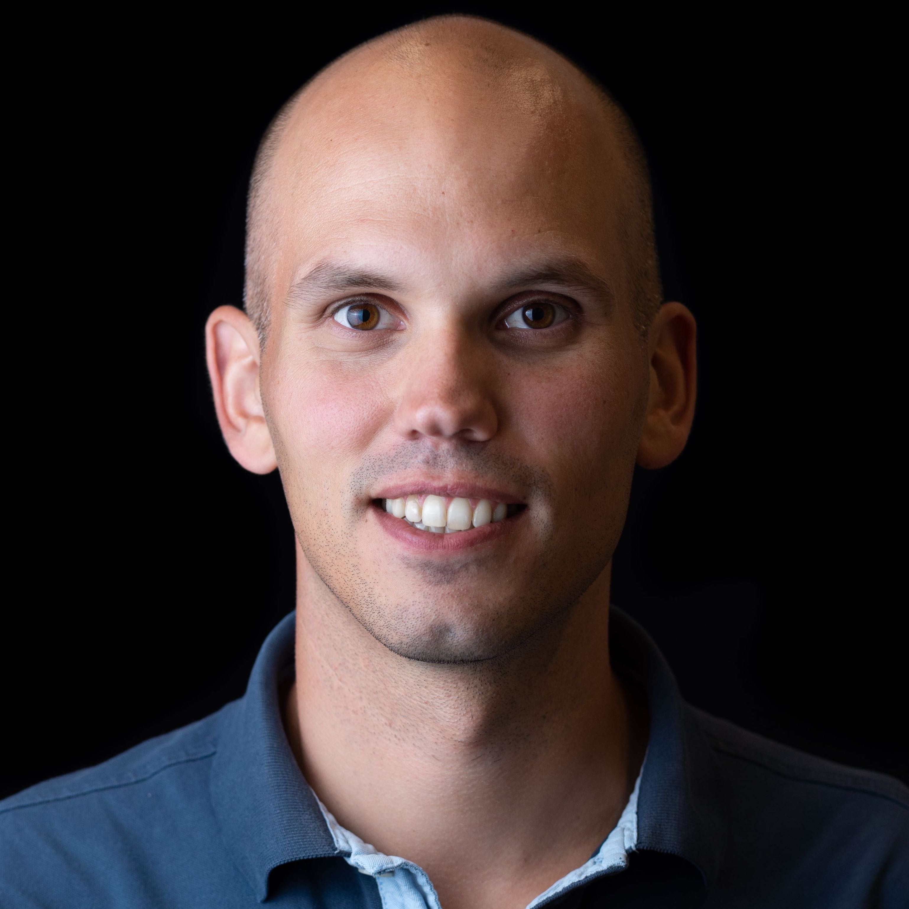

```{css}
/*| echo: false */
body {
  text-align: center
}
```

# <span style='color:#ff2a7fff'><strong>Nice to meet you</strong></span><br>Geert van Geest<br>Facilitator of bioinformatics education

### Would you like to collaborate on projects<br> related to bioinformatics or education? 

<br>

[Let's get in touch](mailto:geert.vangeest@sib.swiss){.btn .btn-primary .btn-lg}


<br>

Since 2025 I am working as a Training Project manager as the [SIB Swiss Institue of Bioinformatics](https://www.sib.swiss), where I am responsible for the development and implementation of training in a wide range of topics and projects. You might also know me from [glittr.org](https://glittr.org) or my involvement in several initiatives related to training at [ELIXIR](https://elixir-europe.org/) - mostly as a co-lead of the [Training Platform](https://elixir-europe.org/platforms/training). 

{width=250}

## Previous experience

### My work at Bern University

At the [IBU](https://www.bioinformatics.unibe.ch/) I worked in close collaboration with the Veterinary science faculty [Vetsuisse](https://www.vetsuisse.unibe.ch/) to support several projects. These projects are related to dog cancer variant analysis, single cell transcriptomics and spatial transcriptomics. They are all projects in which we applied cutting-edge techniques to non-model organisms, like dogs, cats and cows. 

### My work at SIB

At the [SIB Training group](https://www.sib.swiss/training-group) I taught courses on next generation sequencing (NGS), variant analysis, single cell transcriptomics and reproducible science. Find all my courses and their material at [Courses](courses.qmd). At SIB I was also involved in several project related to FAIR training. For example, I co-led the [FAIR training handbook](https://elixir-europe-training.github.io/ELIXIR-TrP-FAIR-training-handbook/) initiative and I created [Glittr.org](https://glittr.org), which was nominated as [SIB Remarkable Output](https://www.sib.swiss/news/discover-the-sib-remarkable-outputs-2023) in 2023. 

### Before moving to Switzerland

Before I moved to Bern in 2020, I did my masters and PhD at Wageningen University at the [Plant Breeding](https://www.wur.nl/en/research-results/research-institutes/plant-research/plant-breeding.htm) research group. There, I developed tools for molecular breeding in chrysanthemum. Amongst others, I co-developed the package [polymapR](https://cran.r-project.org/web/packages/polymapR/index.html), a software package to create genetic linkage maps of outcrossing polyploids. After my PhD, I worked on molecular marker development for [Deliflor Chrysanten B.V.](https://deliflor.nl) a company specialized in developing new varieties of chrysanthemum. 
